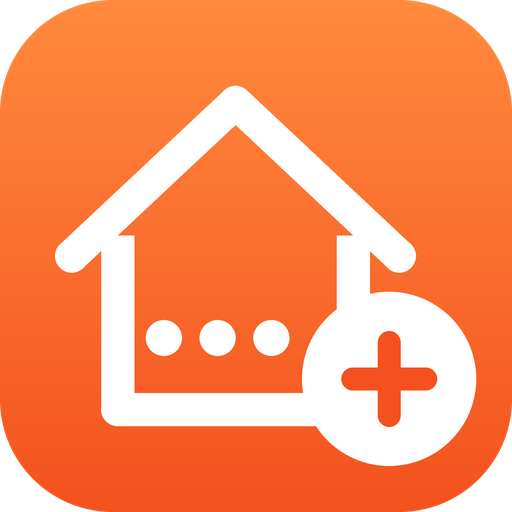
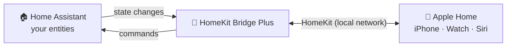

<p align="center">
  
</p>

<h1 align="center">HomeKit Bridge Plus</h1>

<p align="center">
  Bring Home Assistant into Apple Home, exactly the way you want it.<br>
  <a href="https://github.com/MineMax6543/HomeKit-Bridge-Plus/releases"></a>
  <a href="https://github.com/MineMax6543/HomeKit-Bridge-Plus"></a>
</p>

---

HomeKit Bridge Plus exposes your Home Assistant entities to Apple Home, like the built-in
**HomeKit Bridge**, but you decide **what** shows up and **how**: per entity, all from the UI,
no YAML. Changes reach the Home app instantly in both directions.



## Setup

1. **In Home Assistant (2026.11+):** *Settings → Marketplace → Add from link* → `MineMax6543/HomeKit-Bridge-Plus` → install **HomeKit Bridge Plus**. It goes straight into the setup, no restart needed.
2. **Choose a mode:** **Bridge** (many entities, paired once) or **Accessory** (one entity on its own; needed for TVs, best for cameras).
3. **In the Apple Home app:** *Add Accessory* and scan the QR code from the Home Assistant notification (or enter the PIN shown there).

> **Tip:** on Home Assistant 2026.10 or older, add the repository in HACS instead (⋮ → *Custom repositories*, type *Integration*), download it and restart.
> It runs fine next to the built-in HomeKit Bridge, just don't expose the same entity through both.

## What it adds

| | Built-in HomeKit Bridge | HomeKit Bridge Plus |
|---|---|---|
| 🎯 **Choosing entities** | include/exclude filters | explicit list **+** labels, areas, domains, excludes, auto-updates when you re-label |
| 🔀 **Accessory type** | limited, YAML | any sensible type in the UI (switch → light, outlet, fan, valve, sprinkler, **motion or contact sensor** …) |
| 🎛️ **Exposed features** | everything | pick per entity: light without color, fan without oscillation, blind without tilt, cover open/close only |
| 🌡️ **Thermostat & alarm modes** | all / YAML | choose which modes Apple Home offers |
| 🔋 **Linked sensors** | YAML | battery (with low threshold), humidity, motion, doorbell in the UI |
| 🧩 **Several entities in one tile** | – | **Combined accessories** |
| 📺 **TV inputs** | all | pick which inputs appear |
| 📷 **Cameras** | YAML | encoder, resolution, frame rate, audio in the UI |

## What you can expose

| Area | Becomes in Apple Home |
|---|---|
| 💡 **Lights** | Light bulb with selectable brightness, color temperature and color, or switch, outlet, fan |
| 🔌 **Switches & helpers** | Switch, outlet, light, fan, valve, sprinkler, shower, faucet, or any detection sensor |
| 🌀 **Fans & humidifiers** | Fan with selectable speed / oscillation / direction, humidifier or dehumidifier |
| 🪟 **Covers & valves** | Blind (position / tilt selectable), garage door, door, window, valve |
| 🌡️ **Climate** | Thermostat with chosen modes and heat/cool range, water heater |
| 🔐 **Security** | Lock, security system with chosen arm modes and code |
| 📊 **Sensors** | Temperature, humidity, light, CO2, PM2.5, PM10, AQI, motion, occupancy, contact, leak, smoke, CO |
| 🧍 **Presence** | Person or device tracker as occupancy / motion / contact (home = detected) |
| 📺 **Media** | Television or receiver with inputs, volume and remote, or a simple switch |
| 📷 **Cameras** | Live view, snapshots, audio, motion and doorbell |
| ▶️ **Scripts, scenes, buttons** | Switch that resets itself after a press |

## Configuring

Open **Settings → Devices & services → HomeKit Bridge Plus → Configure**. Every change applies
as soon as you submit it: the bridge reloads and the Home app picks it up on its own.

| Menu | What it does |
|---|---|
| Choose entities | The explicit list of exposed entities |
| Include by label / area / domain | Automatic includes (skips hidden, disabled, config and diagnostic entities) plus **Exclude**, which always wins |
| Configure an entity | Name, accessory type, exposed features, linked sensors |
| Combined accessories | Several entities in one HomeKit accessory, e.g. a multi sensor or a fan with its light |
| Bridge settings | Name, port, advertised IP |

## Good to know

<details>
<summary><b>🏷️ Expose things with a label</b></summary>

Create a label such as `HomeKit` and put it on any entity or device, then add the label under
*Include by label / area / domain*. New or re-labelled entities show up in Apple Home by
themselves.
</details>

<details>
<summary><b>📺 TVs and receivers</b></summary>

TVs only work in **accessory mode** (Apple doesn't show bridged TVs reliably). Choose which
inputs appear. Play/pause and next/previous control the media player; the other remote keys
fire `homekit_plus_tv_remote_key_pressed` so you can map them yourself:

```yaml
triggers:
  - trigger: event
    event_type: homekit_plus_tv_remote_key_pressed
    event_data:
      entity_id: media_player.living_room_tv
      key_name: arrow_up
```
Key names: `arrow_up`, `arrow_down`, `arrow_left`, `arrow_right`, `select`, `back`, `exit`,
`information`, `rewind`, `fast_forward`.
</details>

<details>
<summary><b>📷 Cameras</b></summary>

Cameras stream with the ffmpeg Home Assistant already ships. Per camera you can set a stream
URL override, the encoder (`copy` saves CPU for H.264 sources, `h264_v4l2m2m`/`h264_omx` for
Raspberry Pi, `h264_qsv` for Intel), audio, max resolution and frame rate. Link a motion sensor
and a doorbell (binary sensor or event entity) and it shows up as a video doorbell.
Bridged cameras work, accessory mode gives the most reliable live view.
</details>

<details>
<summary><b>🧩 Accessory mode</b></summary>

One entity is paired directly, without a bridge. The options then only show *Choose entity*,
*Configure the entity* and *Bridge settings*. Changing the entity means pairing it again.
</details>

<details>
<summary><b>🔁 Pairing again</b></summary>

`homekit_plus.unpair` removes all pairings of a bridge so you can add it to Apple Home again:

```yaml
action: homekit_plus.unpair
data:
  config_entry_id: <your bridge>
```
</details>

<details>
<summary><b>⚠️ Limits</b></summary>

- A bridge holds max. **150 accessories**. Create a second bridge for more.
- Changing an entity's **type** makes Apple Home see a new accessory (its room and scenes are lost). Changing features is fine.
- HomeKit Secure Video recording is not supported.
</details>

## Troubleshooting

| Problem | Fix |
|---|---|
| Accessories show "No Response" | Check that port **21070** (or yours) is reachable from your Apple TV / HomePod. With several network interfaces or Docker, set the **Advertised IP** in *Bridge settings*. |
| An entity doesn't appear | Open *Configure*: the menu lists skipped entities and why. Sensors without a `device_class` need a type under *Configure an entity*. |
| Removed entity is still in Apple Home | It's probably included by a label, area or domain. Add it to **Exclude**. |
| "Port already in use" during setup | Another bridge (e.g. the built-in one) uses it. Pick a different port. |
| WLED tile only goes dark, not off | You exposed a segment light. Turn off *Keep main light* in the WLED integration or expose the main light. |

## Development

```sh
pip install pytest-homeassistant-custom-component HAP-python PyQRCode base36 ha-ffmpeg
pytest
```

The tests run the integration inside a real Home Assistant instance and talk to it through
the HomeKit protocol layer.

<sub>Not affiliated with or endorsed by Apple or Home Assistant. HomeKit and Apple Home are trademarks of Apple Inc. Community code, not tested or audited by Home Assistant.</sub>
