<p align="center">
  
</p>

<h1 align="center">HomeKit Bridge Plus</h1>

<p align="center">
  Bring Home Assistant into Apple Home, exactly the way you want it.<br>
  <a href="https://github.com/MineMax6543/ha-homekit-bridge-plus/releases"></a>
  <a href="https://github.com/MineMax6543/ha-homekit-bridge-plus"></a>
</p>

---



- **Your choice:** pick exactly which entities appear in Apple Home, what they become and which
  features they show. All in the UI, no YAML.
- **Instant:** changes reach the Home app the moment they happen, and Siri, the Home app and
  your Apple automations control Home Assistant directly.
- **More than the built-in bridge:** labels and areas, combined accessories, TVs with chosen
  inputs, cameras with doorbells, humidifiers and water heaters.

## Install

1. **Settings → Marketplace → Add from link** → `MineMax6543/ha-homekit-bridge-plus`
2. Install **HomeKit Bridge Plus**. It goes straight into the setup, no restart needed.
3. Choose **Bridge** (many entities) or **Accessory** (one entity on its own, needed for TVs).

On Home Assistant 2026.10 or older, add the repository in HACS instead (⋮ → *Custom repositories*, type *Integration*).

## Pair

| | |
|---|---|
| **In Home Assistant** | A notification shows a QR code and the pairing PIN. |
| **In the Home app** | *Add Accessory* → scan the code. Done. |

It runs fine next to the built-in HomeKit Bridge; just don't expose the same entity through both.

## Your choice, per entity



Open **Configure** on the integration. Every change applies as soon as you submit it.

| | |
|---|---|
| 🎯 **Choose entities** | an explicit list, or everything with a label, in an area or of a domain |
| 🔀 **Accessory type** | a switch can be a light, outlet, fan, sprinkler or even a motion sensor |
| 🎛️ **Features** | light without color, fan without oscillation, blind without tilt, thermostat with only Off/Heat |
| 🔋 **Linked sensors** | battery, humidity, motion and doorbell shown on the accessory |
| 🧩 **Combined accessories** | several entities in one tile, e.g. a multi sensor or a fan with its light |
| 📺 **TVs** | inputs you pick, volume, play/pause, remote keys for automations |
| 📷 **Cameras** | live view, snapshots, audio, video doorbell |

## Examples

**Expose with a label:** create a label `HomeKit`, add it under *Include by label / area / domain*,
then put it on any entity or device. It shows up in Apple Home by itself.

**TV remote arrows run your own actions:**

```yaml
triggers:
  - trigger: event
    event_type: homekit_plus_tv_remote_key_pressed
    event_data:
      entity_id: media_player.living_room_tv
      key_name: arrow_up
actions:
  - action: remote.send_command
    target: { entity_id: remote.living_room_tv }
    data: { command: up }
```

## Something wrong?

Turn on **debug logging** on the integration, reproduce the problem, turn it off again and attach
the downloaded log to an [issue](https://github.com/MineMax6543/ha-homekit-bridge-plus/issues).

---

All domains and types, cameras, TVs, limits and troubleshooting:
**[docs/reference.md](docs/reference.md)**

<sub>Not affiliated with or endorsed by Apple or Home Assistant. HomeKit and Apple Home are trademarks of Apple Inc.</sub>
